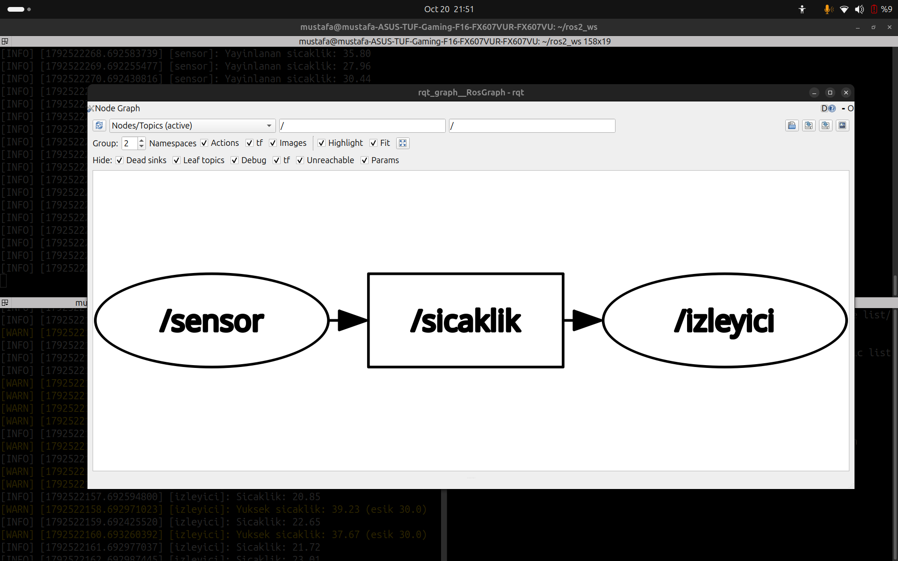
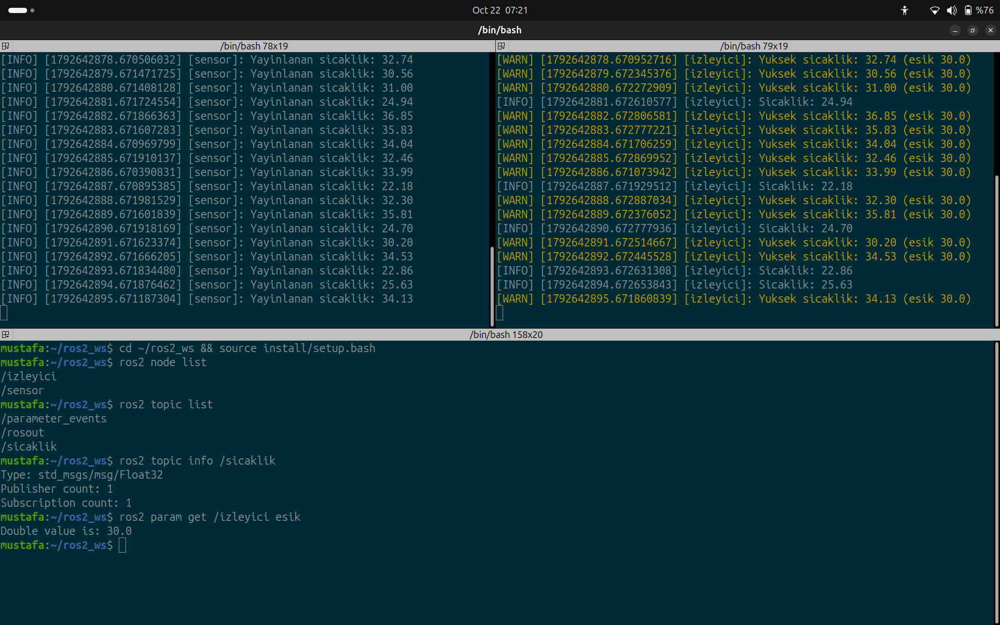

# sicaklik_izleyici_py

ROS 2 Jazzy ile yazılmış basit bir yayıncı/abone örneği.

- **sensor**: Her saniye 20–40 °C arası rastgele bir sıcaklığı `/sicaklik` konusuna `Float32` olarak yayınlar.
- **izleyici**: `/sicaklik` konusunu dinler, değeri ekrana yazar; değer eşiğin üzerindeyse `get_logger().warn()` ile uyarı verir. Eşik `esik` parametresiyle ayarlanır (varsayılan 30.0).

## Derleme

    cd ~/ros2_ws
    colcon build --packages-select sicaklik_izleyici_py
    source install/setup.bash

## Çalıştırma

Terminal 1:

    ros2 run sicaklik_izleyici_py sensor

Terminal 2:

    ros2 run sicaklik_izleyici_py izleyici

Eşiği değiştirmek için:

    ros2 run sicaklik_izleyici_py izleyici --ros-args -p esik:=35.0

## Düğüm grafiği

## Çalışma çıktısı

